# AI Provider Tutorial  

> **Disclaimer:** *This tutorial is to configure AI Providers for the AI Assistant Extra. Please read [AI Assistant](ai-assistant.md) first*


## Overview  
1. Google
2. OpenAI
3. Replicate (Advanced Mode)
4. HuggingFace (Advanced Mode)
5. OpenRouter (Advanced Mode)
6. ComfyUI (Advanced Mode)

## 1. Google
- **Step 1:** Login to your Google account or create a [Google AI Studio Account](https://aistudio.google.com/app/).
- **Step 2:** Navigate to the the [Google API Key Page](https://aistudio.google.com/app/api-keys).
- **Step 3:** Click "Create API Key."
> 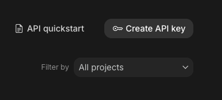
- **Step 4:** Create and copy API Key
> 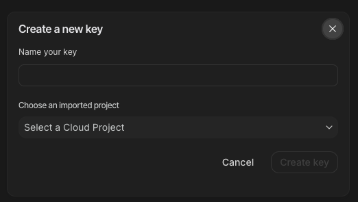
- **Step 4:** Paste the API key into PUMC and adjust the provider settings in PUMC for your desired model, context size, and image quality.
- **Step 5:** *Optional* - Add money to your Google account with Google Billing. Some models work for free, some need payment. All image models are paid models.

## 2. OpenAI
- **Step 1:** Login to your OpenAI account or create an [OpenAI Account](https://platform.openai.com/signup).
- **Step 2:** Navigate to the [API Keys Page](https://platform.openai.com/api-keys).
- **Step 3:** Click "Create New Secret Key" and then click "Create secret key."
> 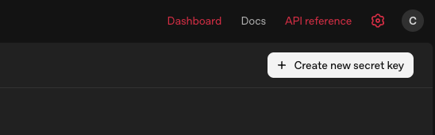
- **Step 4:** Create and copy the new API secret key.
> 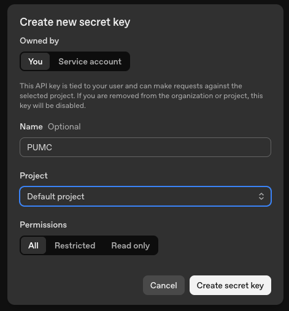
- **Step 5:** Paste the API key into PUMC and adjust the provider settings in PUMC for your desired model, context size, and image quality.
- **Step 6:** Add credit to OpenAI in the [Billing Page](https://platform.openai.com/settings/organization/billing/overview). 

## 2. Replicate (Advanced)
- **Step 1:** Login to your Replicate account or create a [Replicate account](https://replicate.com/).
- **Step 2:** Navitate to the [API Tokens Page](https://replicate.com/account/api-tokens)
- **Step 3:** Enter a token name and click "Create Token."
> 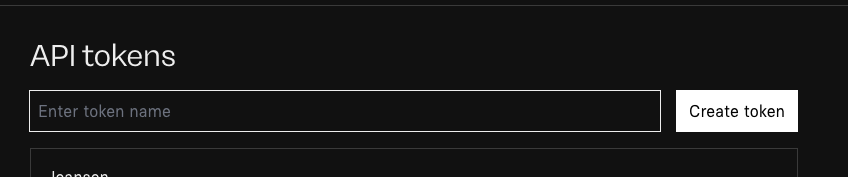
- **Step 4:** Hover over the newly created token, and click "Copy Token."
> 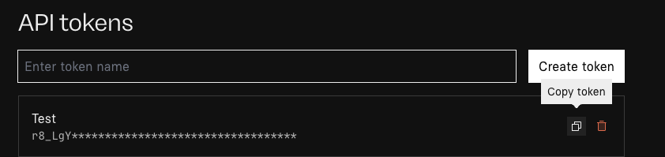
- **Step 5:** Paste the API key into PUMC
- **Step 6:** Add credit to your account on the [Billing Page](https://replicate.com/account/billing)
- **Step 7:** Find the desired model based on the art you want and your budget on the [Models Page](https://replicate.com/collections/text-to-image), and paste the model into PUMC. Adjust the image sized based on your budget.

## 2. HuggingFace (Advanced)
- **Step 1:** Login to your HuggingFace account or create a [HuggingFace account](https://huggingface.co/)
- **Step 2:** Navigate to the [Access Tokens Page](https://huggingface.co/settings/tokens)
- **Step 3:** Click on "Create new token"
> 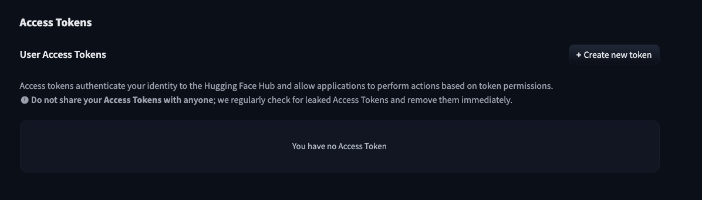
- **Step 4:** Enter your token name and check these three permissions:
> 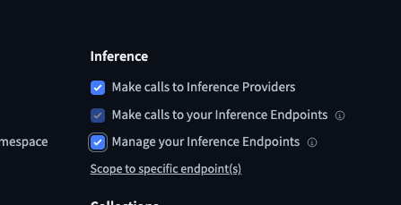
- **Step 5:** Click "Create token"
> 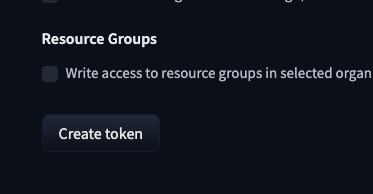
- **Step 6:** Copy token and paste into PUMC settings
> 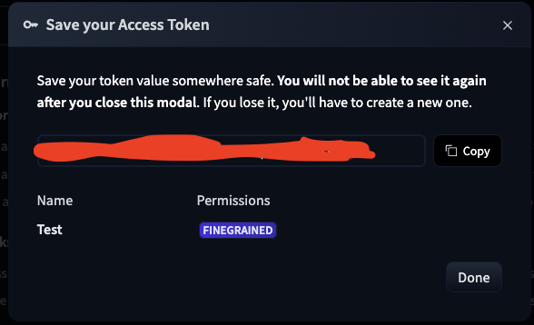
- **Step 7:** Add credits by clicking the "+ Add" button on the [Billing Page](https://huggingface.co/settings/billing)
> 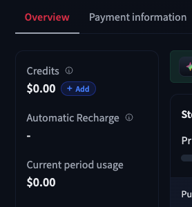
- **Step 8:** Find the desired model based on the art and text you want and your budget on the [Models Page](https://huggingface.co/models), and paste the model name into PUMC settings.  If using image models, adjust the image quality based on your budget.


## 2. OpenRouter (Advanced)
- **Step 1:** Login to your OpenRouter account or create an [OpenRouter Account](https://openrouter.ai/).
- **Step 2:** Navigate to the [API Keys Page](https://openrouter.ai/settings/keys) and click "Create API Key."
> 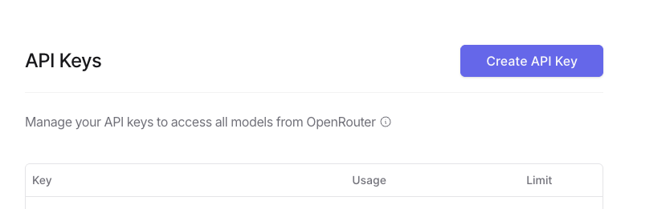
- **Step 3:** Name your API key and click "create."
> 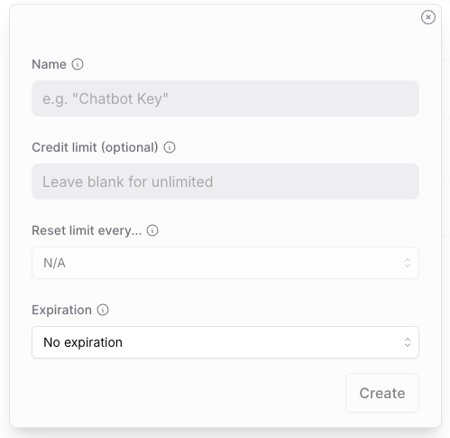
- **Step 4:** Copy the API key and paste it into PUM settings.
- **Step 5:** Find the desired model based on the art and text you want and your budget on the [Models Page](https://openrouter.ai/models), and paste the model name into PUMC settings.  If using image models, adjust the image quality based on your budget.

## 6. ComfyUI (Advanced)
ComfyUI runs image models on your own computer, so images cost no credits. It is for image generation only; you still need a text provider for the rest of the AI Assistant.

- **Step 1:** Install and start [ComfyUI](https://github.com/comfyanonymous/ComfyUI). By default it listens on `http://127.0.0.1:8188`.
- **Step 2:** In PUMC, turn on **Advanced AI**, choose **ComfyUI** as the image provider, and enter your ComfyUI address.
- **Step 3:** Either enter a **Checkpoint** file name to use PUMC's simple built-in workflow, or paste your own workflow into **ComfyUI Custom Workflow**.

### Custom Workflow
In ComfyUI, export your workflow in **API format** (*Export (API)*), then replace the values PUMC should fill in with these placeholders:

| Placeholder | Filled with |
|---|---|
| `{{prompt}}` | The image prompt |
| `{{negative_prompt}}` | The negative prompt |
| `{{seed}}` | A new random seed |
| `{{width}}`, `{{height}}` | The image size |

### Reference Workflow (optional)
With **Visual consistency** set to **Faithful** in the game's AI settings, PUMC can send the portraits and covers of who and what is in a scene along with the image. ComfyUI uses them through a second workflow in **ComfyUI Reference Workflow**, built with whatever reference method your setup supports (IP-Adapter, PuLID, FLUX Kontext, Qwen Image Edit…).

- Use the same placeholders as above.
- Set the `image` of each `LoadImage` node to `{{reference_image_1}}`, `{{reference_image_2}}`, and so on:

```json
"12": {
  "class_type": "LoadImage",
  "inputs": { "image": "{{reference_image_1}}" }
}
```

- PUMC uploads the images to ComfyUI's `input` folder and fills the slots in order. If there are more slots than images, the last image repeats; extra images are left out.
- Images without references, and every image while this field is empty, use your Custom Workflow as usual.

#### Example: FLUX.1 Kontext
[Download the example Reference Workflow](assets/comfyui/pum-reference-workflow-flux-kontext.json) and paste its contents into **ComfyUI Reference Workflow**. It uses FLUX.1 Kontext [dev] with ComfyUI's built-in nodes, no custom nodes needed. Place these files in your ComfyUI `models` folders:

| File | Folder | Download |
|---|---|---|
| `flux1-dev-kontext_fp8_scaled.safetensors` (~12 GB) | `models/unet` | [Comfy-Org/flux1-kontext-dev_ComfyUI](https://huggingface.co/Comfy-Org/flux1-kontext-dev_ComfyUI/tree/main/split_files/diffusion_models) |
| `clip_l.safetensors`, `t5xxl_fp8_e4m3fn.safetensors` | `models/clip` | [comfyanonymous/flux_text_encoders](https://huggingface.co/comfyanonymous/flux_text_encoders/tree/main) |
| `ae.safetensors` | `models/vae` | [Comfy-Org/Lumina_Image_2.0_Repackaged](https://huggingface.co/Comfy-Org/Lumina_Image_2.0_Repackaged/tree/main/split_files/vae) |

The example has one reference slot, so it draws from the portrait of the main character in the scene. It runs on a 16 GB graphics card in under a minute. Local models keep a single character recognisable well, but tend to blend faces when given several references; the cloud providers handle group scenes better. FLUX.1 Kontext [dev] is free for non-commercial use.

