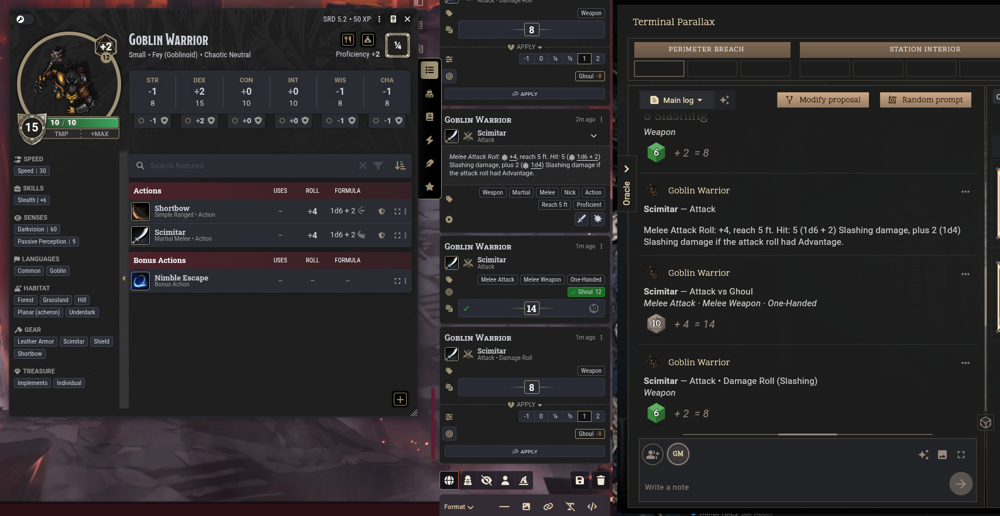

# Foundry VTT Integration

Play with your character sheets in Foundry VTT and keep your journal in PUM Companion. Every roll, attack, spell or item you send to Foundry's chat lands in your PUM Companion log, with the name of the character who did it. Works with any game system.



---

## What You Need

- **PUM Companion on a computer** (Windows, macOS or Linux). The integration isn't available on phones or tablets.
- **Foundry VTT v14**, with your world running. You play in it as usual, in the Foundry app or a browser.
- **The PUM Companion Bridge module**, installed and enabled in that world. Strongly recommended: without it, only plain chat and basic rolls come through, and most game systems' cards don't.

---

## Setting Up

### 1. Install the module in Foundry

1. In Foundry's setup screen, open **Add-on Modules → Install Module**.
2. Search for **PUM Companion Bridge** and install it. If it doesn't appear, paste this manifest URL at the bottom of the window instead:
   `https://github.com/saif-ellafi/foundryvtt-pumc-bridge/releases/latest/download/module.json`
3. Launch your world, open **Game Settings → Manage Modules**, enable **PUM Companion Bridge** and save.

### 2. Create a user for PUM Companion

PUM Companion joins your world as its own user, the way a player would.

1. In your world, open **User Management**.
2. Create a new user, for example `PUMC`, with the **Player** role and a password.
3. You don't need to assign it a character.

### 3. Connect PUM Companion

1. In PUM Companion, open **Application Settings → Integrations**.
2. Switch on **Connect to Foundry VTT**.
3. Fill in:
    - **Server address:** the address you open Foundry at, for example `http://localhost:30000`.
    - **User** and **Password:** the user you created in step 2.
4. Press **Connect**. The status line shows **Connected** with your world's name.

Typing in these fields changes nothing until you press **Connect** (or Enter, or close the tab).

---

## Playing

1. Open a game in PUM Companion.
2. In Foundry, roll from your sheets as usual: attacks, damage, checks, spells, items.
3. Each card appears as a new entry in your PUM Companion log.

**Good to know:**

- **Characters are matched by name.** If a PUM Companion character has the same name as the Foundry speaker, the entry is theirs. Otherwise the entry still shows the speaker's name and portrait.
- **Changes follow along.** When Foundry updates a card, for example a re-roll or a pushed roll, the log entry updates too. If you already edited that entry yourself, your edit stays.
- **Deleting in Foundry never deletes from your journal.** Clearing Foundry's chat leaves your log as it is.
- **Private messages stay private.** Whispers and blind rolls aren't sent to the log.
- **Rolls made before PUM Companion connects aren't picked up.** Connect first, then play.

---

## The Foundry Icon

While the integration is on, an anvil icon sits at the top of the game screen. Hover it to see the status, and click it to open the Integrations settings.

| Icon | Meaning |
|------|---------|
| Small green dot | Connected, and the module is enabled in the world. All good. |
| No badge | Connecting. |
| Orange **!** | Something needs a look: PUM Companion couldn't connect, or the module isn't enabled in this world. |

---

## Connecting and Reconnecting

- **When PUM Companion starts,** it tries to reach Foundry for about a minute, then stops.
- **Started Foundry later?** Click the Foundry icon and press **Connect**.
- **If Foundry restarts during play,** PUM Companion tries to reconnect for about a minute.
- **When you're not using Foundry,** switch the integration off in **Integrations**. PUM Companion then never tries to connect.

---

## Card Pictures

Switch on **Show cards as pictures** to see each card exactly as Foundry draws it, with its fonts, colors and dice icons, instead of as text.

- The card's text is still kept with the entry, for search, copying and the AI Assistant.
- Needs the PUM Companion Bridge module.

---

## Card Formats (Optional)

Most cards read well as they are. If a game system's cards come out cluttered, a **card format** tells PUM Companion how to read them: what to keep, what to skip, and how to lay it out in the log. Formats are saved per game system and apply automatically whenever a world of that system is running.

The **Card format** box in **Integrations** appears once you're connected, labeled with the running world's game system.

### Generate a format with AI

If you have the [AI Assistant](ai-assistant.md):

1. In Foundry, roll about 8 typical things for that system: attacks, damage, checks, item cards. The AI learns from the last 8 cards in your Foundry chat.
2. In **Integrations**, press **Generate with AI**.
3. Roll something in Foundry and check the result in your log. Generate again or tweak the format if needed.

### Use a format someone shared

Paste it into the **Card format** box. It's saved as you type.

### Write or edit your own

Press **Copy example** for a starting point. A format is written in JSON and uses the card's CSS selectors, so it suits players comfortable with a bit of web inspection.

### Example: D&D 5e

A working format for the D&D 5e system (tested on Foundry 14.370). It turns item and feature cards into a bold title with their description, and attack and damage rolls into a title with the target and the roll's tags. Paste it into the **Card format** box while a D&D 5e world is running.

```json
{
  "cards": [
    {
      "when": ".card-description",
      "fields": {
        "title": ".card-header .title",
        "subtitle": ".card-header .subtitle",
        "description": ".card-description .wrapper"
      },
      "template": "**{title}** — {subtitle}\n\n{description}"
    },
    {
      "when": ".dice-roll",
      "fields": {
        "title": ".card-header .title",
        "subtitle": ".card-header .subtitle",
        "target": "target-pill label",
        "damageType": ".tooltip-part .total .label",
        "tags": ".pills .pill .label"
      },
      "template": "**{title}** — {subtitle} {damageType}\n*Target: {target}*\n*{tags}*"
    },
    {
      "fields": {
        "title": ".card-header .title",
        "subtitle": ".card-header .subtitle",
        "tags": ".pills .pill .label"
      },
      "template": "**{title}** — {subtitle}\n*{tags}*"
    }
  ],
  "hide": [
    ".message-header",
    ".item-icon",
    ".activity-icon",
    ".chevron",
    ".fa-tag",
    ".fa-bullseye",
    ".fa-dice",
    ".dice-tooltip-collapser",
    "damage-application"
  ]
}
```

Nothing from Foundry reaches your log while the **Integrations** tab is open, so you can roll sample cards without filling your journal.

---

## Troubleshooting

| What you see | What to do |
|--------------|------------|
| **Can't reach the server** | Check that Foundry is running and the address is the one you use to join your world. Then press **Connect**. |
| **Server found, but no world is running** | Launch your world in Foundry, then press **Connect**. |
| **This world has no user with that name** | Check the **User** field against Foundry's User Management. |
| **Wrong password** | Check the password of the PUM Companion user in Foundry. |
| **Connected, module off** | Enable **PUM Companion Bridge** in **Manage Modules**. |
| Rolls arrive, but other cards don't | Make sure **PUM Companion Bridge** is enabled in your world. |
| A roll didn't arrive | Rolls made while the **Integrations** tab is open, or before connecting, aren't sent to the log. |

---

## Privacy

- PUM Companion only talks to the Foundry server you entered, and to nothing else.
- It reads your world's public chat, and never changes anything in your world.
- When the integration is switched off, PUM Companion doesn't connect at all.
